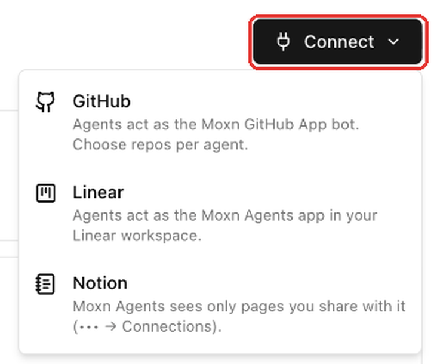
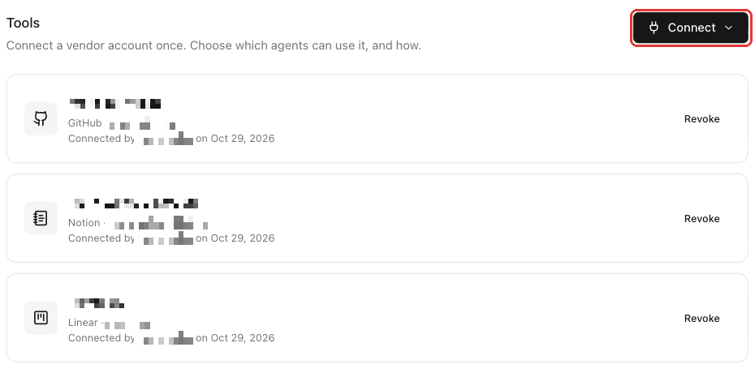
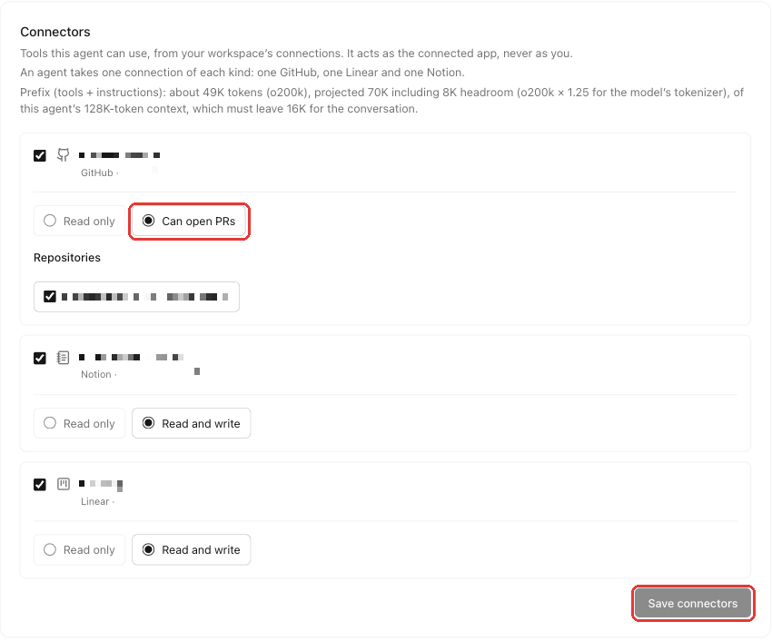
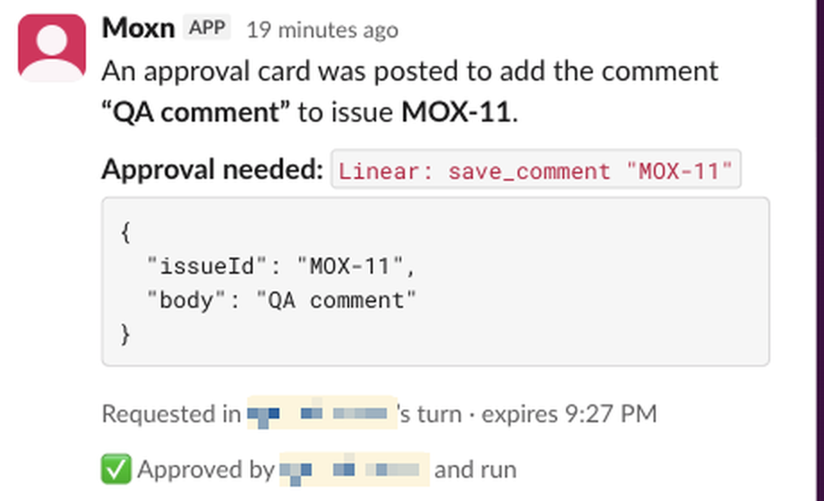
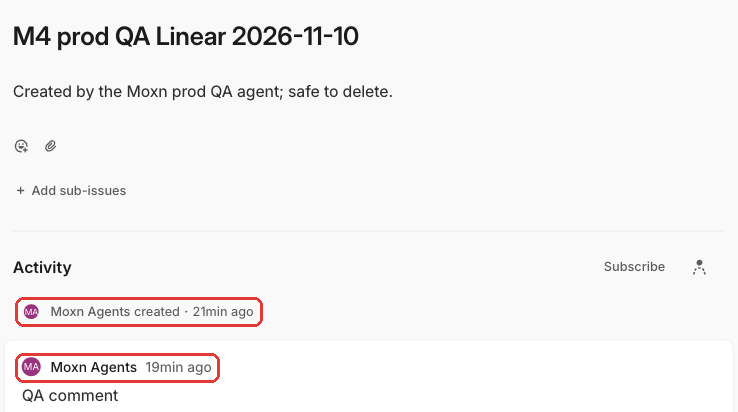
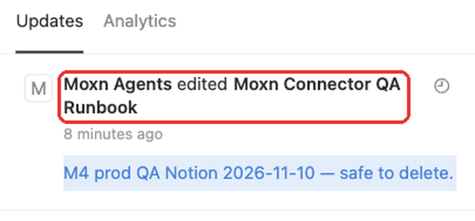
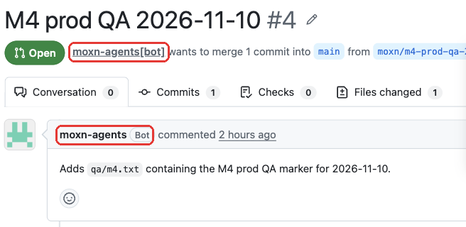
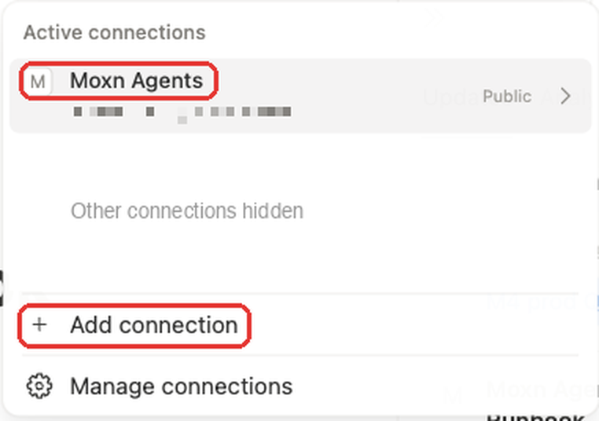

A Moxn agent can work in GitHub, Linear, and Notion as well as in your knowledge base. You connect each account to your Moxn workspace once, then attach it to the agents that should use it and choose how much they may do.

This page walks through the whole path for all three tools. It assumes you already have an agent running in a Slack channel; if not, start with [Set up an agent](/guides/agents/setup).

## How it works

<Steps>
  <Step title="Connect the account">
    In Moxn, go to **Settings > Connections** and use **Connect** in the **Tools** section. You sign in to the tool and approve the Moxn app there.
  </Step>
  <Step title="Attach it to an agent">
    On the agent's page, open the **Access** tab. In **Connectors**, tick the connection, choose an access level, and save.
  </Step>
  <Step title="Use it from Slack">
    Mention the agent and ask. Reads run straight away. Writes post an **Approval needed** card in the thread, and someone in the channel approves it.
  </Step>
</Steps>

| Tool | The agent acts as | Access levels | You choose |
|---|---|---|---|
| **GitHub** | The Moxn GitHub App bot, `moxn-agents[bot]` | **Read only**, **Can open PRs** | Which repositories |
| **Linear** | The **Moxn Agents** app in your Linear workspace | **Read only**, **Read and write** | Access level |
| **Notion** | The **Moxn Agents** integration | **Read only**, **Read and write** | Which pages you share with it in Notion |

<Note>
The agent never acts as you. Everything it creates or changes in these tools is attributed to the Moxn app, not to the person who connected the account or asked in Slack. See [Who the writes are attributed to](#who-the-writes-are-attributed-to).
</Note>

## Before you start

- You need to be an owner, admin, or editor of the Moxn workspace to connect a tool or attach one to an agent. Viewers can see which tools are attached but cannot change them.
- A connection belongs to the workspace and can be shared by several agents. Each agent chooses its own access level, so one agent can be read-only on a tool while another can write.
- An agent takes one connection of each kind: one GitHub, one Linear, and one Notion.

## Connect an account

Go to **Settings > Connections** and find the **Tools** section. Click **Connect** and pick the tool.

<Frame>
  
</Frame>

Each tool you connect appears in the list with who connected it and when. A connection that stops working shows a **Broken** badge; see [Fix a broken connection](#fix-a-broken-connection).

<Frame>
  
</Frame>

The steps differ a little for each tool.

### GitHub

GitHub connects through the **Moxn GitHub App**, which you install on the GitHub account or organization the agent should work in.

<Steps>
  <Step title="Start the connection">
    Choose **GitHub** from **Connect**. GitHub asks you to authorize Moxn so it can see which installations of the app you have access to.
  </Step>
  <Step title="Choose an installation">
    Back in Moxn, **Choose a GitHub installation** lists the accounts where the Moxn GitHub App is installed. Pick one, optionally rename the connection under **Connection name**, and click **Connect installation**.

    Only an admin of a GitHub account can connect its installation. Accounts where you are not an admin are listed but cannot be selected. Ask an admin to connect, or install the app on an account you administer.
  </Step>
  <Step title="Install the app if it isn't there yet">
    If the app isn't installed on the account you want, click **Install on another account**. GitHub's install page lets you choose which repositories the app can reach. When you return to Moxn, click **Finish connecting GitHub**.
  </Step>
</Steps>

When it works, Moxn shows "GitHub connected. Choose repos when you attach it to an agent." The repositories the agent may use are chosen per agent, not here.

### Linear

<Steps>
  <Step title="Start the connection">
    Choose **Linear** from **Connect**. Linear shows a consent screen for the **Moxn Agents** app.
  </Step>
  <Step title="Approve it for your Linear workspace">
    Approve the app. Moxn connects it as an app in your Linear workspace, not as your personal account. If Linear says you can't install apps there, ask a Linear workspace admin to approve it.
  </Step>
</Steps>

When it works, Moxn shows "Linear connected. Attach it to an agent to use it."

### Notion

<Steps>
  <Step title="Start the connection">
    Choose **Notion** from **Connect**. Notion shows a consent screen for the **Moxn Agents** integration.
  </Step>
  <Step title="Choose which pages to share">
    On Notion's consent screen, select the pages the agent should be able to see. The integration can only read and change pages shared with it. You can share more pages later; see [Share Notion pages with the agent](#share-notion-pages-with-the-agent).
  </Step>
</Steps>

When it works, Moxn shows "Notion connected. Attach it to an agent to use it."

<Warning>
If you close the vendor's consent screen or it expires, Moxn shows "authorization was cancelled" or "expired or did not match this browser" and saves nothing. Click **Connect** again to start over, in the same browser.
</Warning>

## Attach a connection to an agent

Connecting an account does not give any agent access to it. You attach it to each agent that should use it.

<Steps>
  <Step title="Open the agent's Access tab">
    Go to **Agents**, open the agent, and select the **Access** tab. The **Connectors** section lists every connection in your workspace.
  </Step>
  <Step title="Tick the connection and choose an access level">
    Tick **Attach** next to the connection. Then choose how much the agent may do:

    | Tool | **Read only** | Higher level |
    |---|---|---|
    | GitHub | Read repositories, issues, pull requests, commits, and code. Clone repositories in the agent's workspace. | **Can open PRs**: also create and comment on issues, open and update pull requests, and push branches whose names start with `moxn/`. |
    | Linear | Read teams, issues, projects, documents, and comments. | **Read and write**: also create and update issues, comments, projects, documents, and similar items. |
    | Notion | Search and read pages, blocks, and databases. | **Read and write**: also add and edit page content and databases, and create pages. |
  </Step>
  <Step title="Pick repositories (GitHub only)">
    Under **Repositories**, tick each repository the agent may use. Choose at least one. The agent can reach only these, even if the GitHub App is installed on more.
  </Step>
  <Step title="Save">
    Click **Save connectors**. Moxn shows "Connectors saved." The new settings apply once any reply that is already running finishes.
  </Step>
</Steps>

<Frame>
  
</Frame>

<Tip>
Start with **Read only**, check that the agent finds the right things, then raise the level. You can change it again at any time.
</Tip>

## Try it in Slack

Mention the agent in its channel and ask for something in the tool. Reads run without approval:

```text
@Moxn list the open pull requests in our docs repository
@Moxn list the Linear teams you can see and the five most recent issues
@Moxn search Notion for the onboarding checklist and summarize it
```

Writes need approval. Ask for one and the agent replies with an **Approval needed** card:

```text
@Moxn create a Linear issue titled "Fix the retry policy" with a short description
@Moxn open a pull request for the change you just made
@Moxn add a paragraph with today's decision to the end of the Notion page "Team notes"
```

## Approve a write

An approval card shows what the agent wants to run: the tool and action, the input (long inputs are shortened), who asked, and when the request expires.

<Frame>
  
</Frame>

While a card is waiting it has three buttons:

| Button | What it does |
|---|---|
| **Approve** | Runs this one action. |
| **Deny** | Refuses it. Nothing runs. |
| **Allow for this session** | Runs it, and lets the same tool and action run without asking for the rest of this conversation. |

After a decision the buttons are replaced by a line saying what happened, for example "Approved by @name and run" or "Denied by @name".

- **Anyone in the channel can approve.** Any person in the agent's channel can decide, not only the person who asked. Bots cannot.
- **Cards expire.** If nobody decides within about 30 minutes, the card reads "Expired: nobody decided in time" and nothing runs. Ask the agent again.
- **Approving runs one action.** If the task has more steps, ask the agent in the same thread to continue.

### Reviewing tool writes

Read the card before you approve. The input shown is what will be sent to the tool. Some cards end with a warning instead of "and run":

| Card says | What it means |
|---|---|
| "Approved by @name, but the call failed" | The tool returned an error. The card shows the reason; check the tool before you ask again. |
| "Approved by @name, but the agent stopped while running it" | The outcome is unknown. Check the result in the tool itself before asking the agent to try again, so you don't create a duplicate. |
| "Not run" | The action did not run. The card says why. |

### Change what needs approval

By default, reads run on their own and writes ask. To change that per tool, use **Tool approvals** on the agent's **Access** tab. Each tool can be set to **Allow**, **Ask**, or **Deny**, and a change applies after you click **Save tool approvals**. See [Tools, connections, and permissions](/guides/agents/tools-and-permissions).

## Who the writes are attributed to

Everything the agent writes is attributed to the Moxn app in each tool, never to the person who connected the account or who asked in Slack. People reviewing the result can tell at a glance that an agent did it.

### Linear

Issues and comments appear as **Moxn Agents**, an app account in your Linear workspace.

<Frame>
  
</Frame>

### Notion

Edits appear as **Moxn Agents**. In a page's **Updates** panel they read "Moxn Agents edited".

<Frame>
  
</Frame>

### GitHub

Pull requests, comments, and commits are authored by the GitHub App's bot, `moxn-agents[bot]`.

<Frame>
  
</Frame>

## Share Notion pages with the agent

The Notion integration sees only the pages you share with it. A page it cannot see does not exist as far as the agent is concerned, so if the agent says it can't find something, share the page first.

<Steps>
  <Step title="Open the page in Notion">
    Open the page you want the agent to use.
  </Step>
  <Step title="Open the page's Connections menu">
    Click the **•••** menu at the top right, then choose **Connections**. If you don't see it, search the menu for "Connections".
  </Step>
  <Step title="Add Moxn Agents">
    Click **Add connection** and choose **Moxn Agents**. The agent can now see the page and the pages nested inside it.
  </Step>
</Steps>

<Frame>
  
</Frame>

To stop sharing a page, remove the connection from the same menu.

## Fix a broken connection

A connection breaks when the tool stops accepting it: the app was uninstalled, access was removed, or the grant was revoked in the tool. Moxn shows what happened in **Settings > Connections**:

| Message | What happened |
|---|---|
| "Access was removed at the vendor." | Someone removed the Moxn app's access in GitHub, Linear, or Notion. |
| "The vendor stopped accepting this grant." | The tool no longer accepts the connection's credentials. |
| "The app was uninstalled at the vendor." | The Moxn app was uninstalled from the account. |

<Steps>
  <Step title="Reconnect">
    On the broken connection, click **Reconnect** and approve the app again in the tool. Use the same account you connected before.
  </Step>
  <Step title="Check the agent">
    The agent's attachment is kept. Until you reconnect, the agent's **Connectors** section shows "Needs reconnecting in Settings" and its access level can't be changed. After you reconnect, the agent can use the connection again.
  </Step>
</Steps>

To remove a connection for good, click **Revoke** and confirm. Every agent using it loses access to that tool at its next configuration update, after any running replies finish. Moxn erases the stored grant, and this cannot be undone. To use the tool again, connect it from scratch.

## Current limits

These limits apply today and may change.

- Agents can't permanently delete items, merge pull requests, or comment in Notion.
- Agents can push to GitHub only on branches whose names start with `moxn/`, and never to a repository you did not tick.
- Agents see only what you gave them: the ticked GitHub repositories and the Notion pages shared with **Moxn Agents**.
- An agent has one GitHub, one Linear, and one Notion connection.

## Related

- [Tools, connections, and permissions](/guides/agents/tools-and-permissions): the agent's identity, per-tool approvals, and what an agent can touch.
- [Working with the agent in Slack](/guides/agents/using-in-slack): mentions, threads, `task`, and `fork`.
