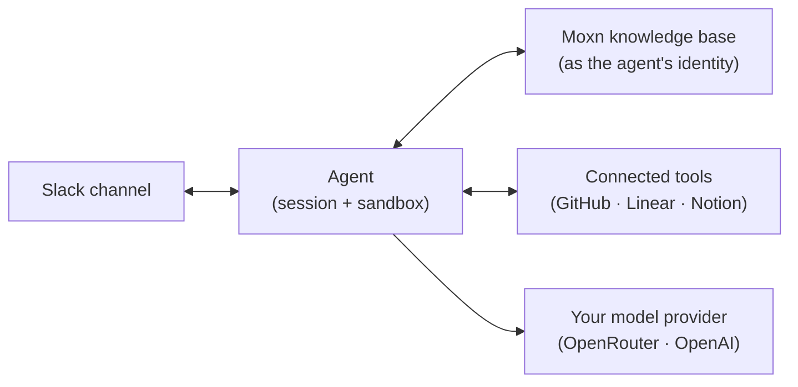

A Moxn Slack agent is an AI teammate that lives in one Slack channel. It answers questions from your workspace's Moxn knowledge base, does work with the tools you connect, and writes what it learns back into Moxn.

That last part is the point. Decisions, findings, and hard-won context usually stay buried in Slack threads. An agent that records them in your knowledge base turns each conversation into durable, searchable knowledge that people and other agents can build on.

## The mental model

An agent is a small set of pieces, each configured once in the web app:

| Piece | What it is |
|---|---|
| **Channel** | The one Slack channel the agent lives in. Each channel has at most one agent. |
| **Identity** | The agent's own Moxn member (a bot), with its own permissions. It is separate from the person chatting with it. |
| **Model connection** | Your OpenRouter or OpenAI account. Your provider bills you directly for usage. |
| **Knowledge base** | A Moxn filesystem the agent reads and writes, plus a memory folder for its working notes. |
| **Tools** | Optional GitHub, Linear, and Notion access, scoped to the repositories, teams, and pages you choose. |
| **Sessions** | Running conversations. The channel has a main session, and each thread can have its own. Every session runs in an isolated sandbox. |

## How it works in a channel

The agent reads the channels it has been invited to. It replies when you @mention it and when you reply in a thread it is part of. For other channel messages, it decides whether a reply is useful.

How you address it controls what it remembers. A plain mention continues the channel's shared conversation. `task` starts a clean thread, and `fork` starts a thread that carries the channel's context with it. See [Working with the agent in Slack](/guides/agents/using-in-slack).

## What you need

- A Moxn workspace and access to its **Agents** page.
- An OpenRouter or OpenAI API key.
- Permission to install apps in your Slack workspace.
- A Moxn filesystem for the agent to use as its knowledge base.

<Note>
Agents work in public channels and in private channels the app is invited to. Shared channels (Slack Connect), direct messages, and group DMs are not supported yet. During the current pilot, enabling an agent is available to pilot-approved workspaces. Contact Moxn to join.
</Note>

## Next steps

<CardGroup cols={2}>
  <Card title="Set up an agent" icon="list-check" href="/guides/agents/setup">
    Connect a model, connect Slack, and enable your first agent
  </Card>
  <Card title="Working in Slack" icon="slack" href="/guides/agents/using-in-slack">
    Mentions, threads, and the `task` and `fork` commands
  </Card>
  <Card title="Models and cost" icon="gauge" href="/guides/agents/models-and-cost">
    Pick a model and reasoning effort, and keep usage predictable
  </Card>
  <Card title="Knowledge and memory" icon="brain" href="/guides/agents/knowledge-and-memory">
    How the agent uses your knowledge base as durable memory
  </Card>
  <Card title="Tools and permissions" icon="key" href="/guides/agents/tools-and-permissions">
    The agent's identity, connected tools, and what it can touch
  </Card>
  <Card title="Operations" icon="wrench" href="/guides/agents/operations">
    Replies, sessions, paused requests, and retiring an agent
  </Card>
</CardGroup>
